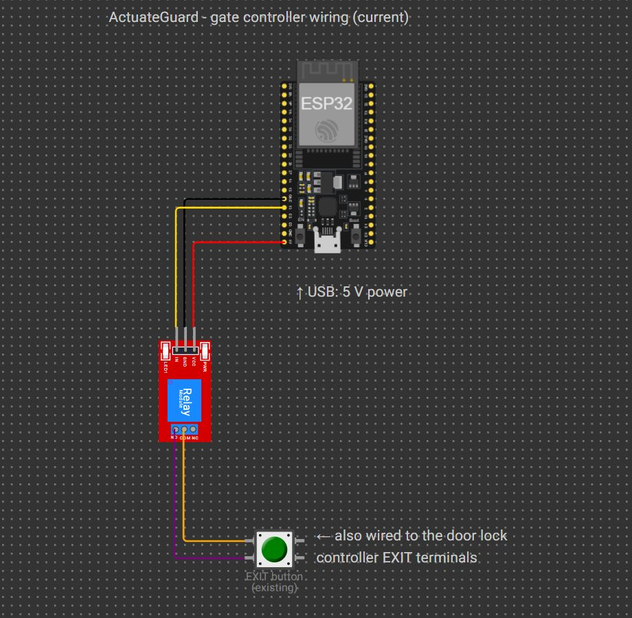

# ActuateGuard

Secure, per-person access for the robotics club gate. Phones open the gate over Bluetooth using **signed, revocable grants** in place of one shared password. Every attempt is logged.

> **Status: Phase A (mock build).** Everything here uses throwaway keys and a throwaway backend. Nothing in this repo can open the real gate.

<!-- PHOTO: hero image of the gate board on the bench → docs/photos/board-bench.jpg (see issue "Photo: gate board on the bench") -->
<p align="center"><i>Photo coming soon: the gate controller on the door</i></p>

---

## How it works (30-second version)

1. **You get invited.** An admin gives you a one-time invite code. The app makes a key pair inside your phone's security chip, and the private key never leaves the phone.
2. **An admin approves you in person.** They check that a 6-digit code on your phone matches the one on their dashboard, then approve with their **passkey**. From then on the backend's *signer* issues you **grants**: signed notes saying "this phone may open gate X from date A to date B", renewed automatically.
3. **At the gate,** your phone gets a random challenge, signs it, and sends it with your grant. The gate checks everything **offline** using only public keys, then opens the relay.
4. **Revoking** someone means their grant stops being renewed and goes on a signed revocation list that the gate pulls over HTTPS.
5. **Every attempt is logged** (allowed or denied, with the reason), buffered on the gate, and uploaded when online.

Bluetooth signal strength only *starts* the check. Being close to the gate alone never opens it.

Full details: **[docs/design.md](docs/design.md)**.

---

## The hardware: a small hack

We didn't replace or open up the door lock. The lock's controller already has an **electronic exit button**: the push button you press to get out. Pressing it briefly connects two wires, and the controller releases the lock.

So the ESP32 just **presses that button for us**:

1. A **relay module** sits behind the ESP32. Its **COM** and **NO** contacts are wired **in parallel** across the exit button's two wires.
2. When a phone passes the check, the ESP32 drives **GPIO 13** to switch the relay on. COM and NO connect, which is exactly what pressing the button does.
3. After about 3 seconds the relay switches off again, like letting go of the button.



**Why it's a nice hack**
- **No changes to the lock.** The relay acts as a second, invisible exit button.
- **The original button still works.** It's wired in parallel, so pressing it does the same thing as before.
- **If the ESP32 or relay dies, nothing opens.** An unpowered relay leaves NO open, which is the same as nobody pressing the button. The inside button and the mechanical key still work.

**The one rule this hack imposes:** the relay must **stay off while the ESP32 boots or resets**. An active-low relay module (on when its input is LOW) that sees LOW during boot looks to the lock like someone *holding* the exit button. The firmware must set the "off" level before it enables the pin, and must cap how long the relay can stay on. See [design.md §8.2](docs/design.md#82-relay-safety-avoid-repeating-the-old-firmwares-bugs).

The wiring diagram was drawn in [Wokwi](https://wokwi.com). Parts list and pin notes are in [hardware/README.md](hardware/README.md).

---

## Security and cryptography

The design assumes **everything in this repo is public**: the code, the protocol, the formats. The security comes only from private keys that never appear here. If this section and [docs/design.md](docs/design.md) ever disagree, the design doc wins. Values marked *(D#)* are proposals that are still open decisions.

### Algorithms

| What | Choice | Why |
|---|---|---|
| Signatures (phones and signer) | **ECDSA P-256** (secp256r1) with **SHA-256** | The only curve that is hardware-backed on both Android Keystore and the iOS Secure Enclave. The ESP32's bundled mbedTLS verifies it. One algorithm means one way to verify, which keeps the code small to review. |
| Phone private key | Generated **inside** Android Keystore (StrongBox if available) / iOS Secure Enclave, **can't be exported** | The key can't be copied off the phone, even by the app itself. |
| Gate crypto library | **mbedTLS** (ships with the ESP32 core) | Standard, maintained library. No hand-rolled crypto. |
| Challenge nonce | **32 bytes** from the ESP32 **hardware RNG**, single-use, expires after **10 s** | Makes every unlock unique, so recordings can't be replayed. |
| Gate ↔ backend | **HTTPS**, outbound only, server certificate checked against a **stored CA certificate** | No open ports on the gate. A fake server can't impersonate the backend. |
| Invite codes | Random (≥ 40 bits), one-time, expire after 48 h, stored only as **SHA-256(code)** | A database leak doesn't reveal usable codes. |
| Key fingerprint | First 20 bits of **SHA-256(phone public key)**, shown as 6 digits on the phone and on the dashboard | The admin can confirm the phone being approved is really the one in front of them, not someone who intercepted the invite. |
| Admin approvals | **WebAuthn passkey** (ES256) assertion over `SHA-256("AGv1-APPROVE" ‖ approval record)`, checked by the signer against admin keys **pinned in its own config** | A hacked backend or database can't create access. Only an admin's passkey can. |
| Gate time | DS3231 RTC, synced with a **signer-signed** `time ‖ nonce` (`AGv1-TIME`), never moved back past a stored floor | Nobody can wind the clock back to bring expired grants back to life. |
| Domain separation | Every signed message starts with a tag: `AGv1-GRANT`, `AGv1-AUTH`, `AGv1-RVK`, `AGv1-TIME`, `AGv1-APPROVE` | A signature made for one purpose can't be reused for another. |

**Encoding:**
- **Public keys:** uncompressed P-256 points (65 bytes, `0x04‖X‖Y`).
- **Signer signatures:** raw `r‖s` (64 bytes).
- **Phone signatures:** DER (≤ 72 bytes), which is what the phone keystores produce natively.
- **Integers:** big-endian. **Times:** Unix seconds as `u32`.

### Keys: who holds what

| Key / secret | Held by | If it leaks |
|---|---|---|
| **Signer private key** | Signer service only *(storage: D4, proposal: cloud KMS)* | **Full access.** One of only two critical secrets. Recovery: new signer key, reprovision the gate, re-issue all grants. |
| **Admin passkey** | The admin's own device, can't be exported. Public keys are pinned in the signer's config. | An attacker could approve their own phone. Every approval alerts all admins. Recovery: unpin that key, revoke what it approved. |
| Signer public key | Gate (NVS) + backend | Nothing. It's public. |
| Phone private key | That phone's security chip, can't be exported | Only that one phone's access. Revoke it. |
| Grant | Phone (ordinary storage) | Nothing. It's useless without the matching phone private key. |
| Invite code | The invited person, once | Someone else could enroll their phone, but the admin won't approve it: the 6-digit fingerprint won't match. Expires in 48 h. |
| Gate log token | Gate (NVS), one per gate, can be rotated | Can only **add** log rows. Fake rows are kept and flagged as `seq` conflicts, never allowed to push out real ones. It can't read logs or open anything. |
| WiFi password | Gate (NVS) | WiFi access only. |
| Backend / database credentials | Backend environment secrets | **No gate access.** The signer only acts on admin-passkey approvals. An attacker could read user records and logs, and block people, but not let anyone in. |

**The gate holds no secret that can open the gate.** Device-specific values are written into the ESP32's NVS storage at provisioning time and are never compiled into the firmware. A leaked firmware binary gives away nothing.

### The grant (175 bytes)

A grant is the signer's signed statement that a particular phone may open a particular gate for a particular time window.

| Field | Bytes | |
|---|---|---|
| `version` | 1 | `0x01` |
| `grant_id` | 16 | Random. This is what gets revoked and logged. |
| `user_id` | 16 | |
| `gate_id` | 4 | Only valid on this gate |
| `kind` | 1 | member / guest (anything else is rejected) |
| `valid_from` | 4 | |
| `valid_until` | 4 | Member 7 days with automatic refresh; guest set per invite; mock ≤ 1 h *(D5)*. Never later than the admin approval's end date. |
| `phone_pubkey` | 65 | The phone that's allowed to use this grant |
| `signer_sig` | 64 | ECDSA over `"AGv1-GRANT" ‖ all fields above` |

### The unlock exchange (BLE)

```
Phone                                            Gate (ESP32)
  │ ── HELLO ─────────────────────────────────────▶ │
  │ ◀──────────────── nonce (32 B) ‖ gate_id (4 B) ─ │   new random nonce, 10 s TTL
  │                                                  │
  │  phone_sig = ECDSA(phone_key,                    │
  │      "AGv1-AUTH" ‖ gate_id ‖ nonce ‖ grant_id)   │
  │                                                  │
  │ ── grant (175 B) ‖ phone_sig (≤72 B) ─────────▶ │   checks below, all offline
  │ ◀──────────────────── OK / DENIED / TRY_AGAIN ── │   relay pulses on OK
```

Bluetooth signal strength only **triggers** the exchange; it never decides anything. The phone only learns OK, DENIED or TRY_AGAIN. The exact reason goes to the log, so an attacker can't tell which part of their attempt failed. If the handshake isn't done within about 5 s, the gate drops the connection. Rate limits are per connection, plus a global cap on signature checks, so a stranger can't lock everyone out.

### What the gate checks, in order (cheapest first)

1. Format and version: `BAD_FORMAT`
2. `gate_id` matches this gate: `WRONG_GATE`
3. Clock is valid (DS3231 RTC set): `CLOCK_INVALID`
4. `valid_from ≤ now ≤ valid_until`, with ±2 min drift slack: `NOT_YET_VALID` / `EXPIRED`
5. *(mock builds only)* grant lasts ≤ 1 hour: `GRANT_TOO_LONG`
6. Neither the `grant_id` nor the `user_id` is on the revocation list: `REVOKED`
7. Signer signature on the grant is valid: `BAD_GRANT_SIG`
8. `phone_pubkey` is a valid P-256 point, and the phone signature on `gate_id ‖ nonce ‖ grant_id` verifies with it: `BAD_PHONE_SIG`
9. All checks pass: **open** (`OK`)

The cheap checks come first, so junk is rejected before the gate spends time on the slow P-256 signature checks.

### Revocation

- The signer publishes a **signed revocation list**: `version ‖ issued_at ‖ gate_id ‖ count ‖ entries[] ‖ signer_sig` (tag `AGv1-RVK`). Each entry is a `grant_id` (one grant) or a `user_id` (**every** grant that person holds).
- **Revoking a person blocks all their grants.** Grants refresh at half-life, so people usually hold two valid ones; a `user_id` entry covers both.
- The gate pulls the list over HTTPS every **5 min** *(D6)* and keeps the newest one in NVS.
- **The version must always increase.** The gate rejects any list whose version is lower than or equal to the one it has, so an old list can't be replayed to bring a revoked grant back.
- A fake server can't change the list either, because it's signed by the signer, not just sent over TLS. The signer never drops a live entry because the API asks; restoring someone needs a new admin-passkey approval.
- **Offline limit:** if the gate can't reach the backend, a revoked grant still works until its `valid_until`. That's why member grants are short (7 days) and refresh automatically. Admins are alerted when a gate has been offline for more than 1 hour, because blocking its internet could be deliberate.

### Access log

- Every attempt is logged, allowed or denied: `seq ‖ gate_id ‖ timestamp ‖ grant_id ‖ user_id ‖ result ‖ reason`.
- `user_id` comes only from a **verified** grant, never from what the phone claims.
- Events are buffered in a **flash ring buffer** and uploaded over HTTPS when online, so logs survive WiFi outages.
- `seq` increases per gate and is never reused, so **gaps reveal dropped or deleted events.**
- The server stores logs **append-only**. The gate's token can only insert, and nothing can update or delete except the 90-day retention job. Rows with a clashing `seq` are **kept and flagged**, never dropped.
- Timestamps come from the **DS3231 RTC**, synced with signer-signed time. If the clock isn't set and there's no network, the gate denies (and the inside button and mechanical key still work).
- **Members are told they're logged.** The app says so during onboarding (what's recorded, kept for 90 days, visible to admins), before any key is created.
- A log entry means "this grant opened the gate", not "this person walked in". Tailgating and shared phones aren't detected.

### Threats at a glance

| Attack | Outcome |
|---|---|
| Replay a recorded unlock | ❌ Fails: the nonce is single-use, expires in 10 s, and is covered by the signature |
| Copy someone's grant | ❌ Useless without their phone's private key |
| Dump the ESP32's flash | ❌ No way to open the gate: only public keys, the WiFi password and the log token |
| Read this repo | ❌ Nothing gained: there are no secrets in it by design |
| Old revocation list / fake backend | ❌ The version must increase, and the list is signed |
| Hack the backend or database | ❌ No gate access: grants need an admin-passkey approval the signer checks itself |
| Use an intercepted invite code | ❌ The admin won't approve: the 6-digit key fingerprint won't match |
| Revoked person uses their older grant | ❌ Revocation covers every grant they hold (`user_id` entry) |
| Wind the gate's clock back | ❌ Time sync is signed, and the gate never goes back past its stored floor |
| Flood fake log rows with a leaked token | ❌ Real events can't be pushed out: clashes are kept and flagged. Rotate the token. |
| Block the gate's internet to dodge a revocation | ⚠️ Works until the grant expires *(D5)*; admins are alerted after 1 h offline |
| Bluetooth flooding / holding the connection | ⚠️ Nuisance only: idle timeout and per-connection limits; the physical key still works |
| Stolen phone | ⚠️ Revoke it; locked out at the next sync, or by grant expiry at the latest. Unlock may require the phone to be unlocked *(D2)* |
| **Relay attack** (forwarding messages between a member's phone and the gate) | ⚠️ **Accepted residual risk.** The gate can't prove its identity without holding a private key. Reduced by requiring the phone to be unlocked or recently used *(D2)* |
| **Signer key compromise** | 🚨 Full access. That's why it lives in KMS *(D4)* |
| **Admin passkey compromise** | 🚨 Could approve a phone. Passkeys can't be exported, and every approval alerts all admins |
| Power cut / crash | ✅ The relay must start off; a dead relay = button not pressed |

The full threat list is a Phase A deliverable: [docs/threats.md](docs/threats.md).

### Mock vs production

- **Phase A** uses a **throwaway signer key** (held by one named person, never in the repo or chat), a throwaway backend, and firmware that rejects grants longer than ~1 hour.
- **Phase B** swaps in the production signer key, admin passkeys, backend and gate config, **with no code changes**. It also turns on ESP32 **secure boot and flash encryption**, disables JTAG, and sets secure download mode, so the USB port can't read the board or load unsigned firmware.
- **Firmware is never auto-deployed.** It's flashed by hand (or later by signed OTA only), from a signed git tag whose binary hash is recorded at cutover.

---

## Repo layout

| Folder | What goes there |
|---|---|
| [`firmware/`](firmware/) | ESP32 gate firmware: BLE, grant checking, relay, RTC, logs |
| [`app/`](app/) | Phone app (platform decided in the design review, D1) |
| [`backend/`](backend/) | API and the **signer** (the only part that holds a private signing key) |
| [`dashboard/`](dashboard/) | Admin web dashboard: approve, revoke, guest access, logs |
| [`tools/`](tools/) | Mock key generation, ESP provisioning, grant inspector |
| [`hardware/`](hardware/) | Parts list and wiring diagram |
| [`docs/`](docs/) | Problem statement, design doc, threat list, cutover checklist, live-board rules, photos |

---

## Getting started

1. Read [docs/problem-statement.md](docs/problem-statement.md) (what we're building and the rules), then [docs/design.md](docs/design.md) (how). The design doc is the build spec: follow it section by section. If you find something wrong in it, fix the doc in a PR first, then the code.
2. Read [docs/live-board.md](docs/live-board.md) **before touching the real gate board.**
3. Pick an [open issue](../../issues). Issues labelled `good first issue` (mostly photos and docs) are a good warm-up.
4. Branch from `main`, open a PR, and get a review. `main` is protected.

---

## Rules (non-negotiable)

- **No secrets in the repo, ever:** no keys, tokens, WiFi passwords or `.env` files. This repo is public. Secret scanning is on, and a leaked secret means rotating it, not just deleting the commit.
- **The gate holds public keys only.** Device-specific values go into the ESP's NVS storage at provisioning time, never into source code.
- **Signal strength alone never opens the gate.**
- **Standard crypto libraries only** (mbedTLS on the ESP, platform keystores on phones). No hand-rolled crypto.
- **The inside release and mechanical key must keep working at all times.**
- Changes to `firmware/src/auth/`, `backend/signer/` and `tools/keygen/` need review from @shreyansh-malviya (see [CODEOWNERS](.github/CODEOWNERS)).

Found a security problem? See [SECURITY.md](SECURITY.md). Please don't open a public issue for it.

---

## Photos

<!-- Add photos to docs/photos/ and replace the placeholders below. Each one has an issue. -->

| | |
|---|---|
| *📷 Gate board on the bench* | *📷 Relay module close-up* |
| *📷 Exit button and relay wiring on the bench* | *📱 App screenshots* |
| *🖥️ Dashboard screenshots* | |

**Never post photos of the installed gate:** not its location, the outside of the gate, the enclosure in place, the lock model, or the wiring where it's mounted. This is a public repo, and those photos would show an attacker where to work. See [docs/photos/README.md](docs/photos/README.md).

---

## Team

Built by the robotics club (`actuate-sst`).

- **Project lead, architecture and building:** @shreyansh-malviya. Also owns review of the security-critical paths (see [CODEOWNERS](.github/CODEOWNERS)) and runs the Phase B cutover.
- **Contributors:** the robotics club team. Add yourself here in your first PR.
