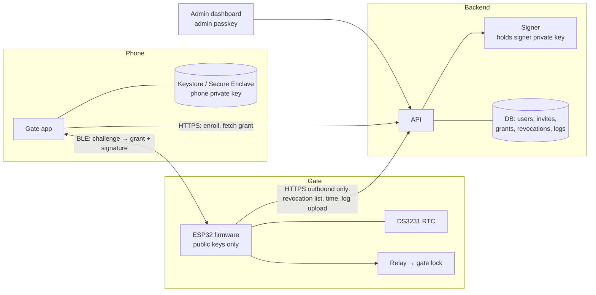

# Gate Access v2: Design

**Status:** Draft, open decisions in §13 · **Author:** @shreyansh-malviya · **Last updated:** 2026-11-18

This replaces the current gate login, where everyone types in one shared HMAC key. The new system gives each person their own revocable access using signed grants, supports temporary guest access, and keeps an access log.

**How to use this doc:** it's the build spec. Implement it section by section, as written. If something turns out to be wrong or impossible, change this doc in a PR **first**, then the code. The code should never quietly drift away from the design.

---

## 1. Goals

- **Per person:** every phone has its own key pair. The private key never leaves the phone.
- **Revocable:** one person's access can be removed without touching anyone else.
- **Temporary access:** a guest is just a grant with a short expiry.
- **Works offline:** a valid grant opens the gate even when WiFi or the backend is down.
- **Logged:** every attempt, allowed or denied, is recorded with the reason.
- **Config-driven:** moving from the mock setup (Phase A) to production (Phase B) changes keys and config only, never code.
- **Safe to publish:** the repo and the firmware image contain no secrets, so the code can be public. The design's security must not depend on the code being hidden.

**Out of scope:** production keys, flashing the live gate with real keys, secure boot and flash encryption (all Phase B).

**Hard rules this design must keep** (from the brief):
- The ESP holds public keys only.
- Proximity alone never opens the gate.
- A valid grant works offline.
- The gate always opens from inside.
- Standard crypto libraries only.

---

## 2. System overview



**Who trusts what**

| Component | Holds | Trusts |
|---|---|---|
| ESP32 | Signer **public** key, gate ID, backend URL, CA cert. Also a WiFi password and a write-only log token, stored in NVS (see §4). | Grants signed by the signer key |
| Phone | Its own private key (hardware-backed, can't be exported) plus its current grant (not secret) | The backend over HTTPS |
| Signer | The signer **private** key: the most valuable secret in the system. Also the **admin passkey public keys**, pinned in its own config. | **Only** approvals signed by an admin's passkey (§7.1). It does **not** trust the API or the DB. |
| Backend / DB | User records, invite-code *hashes*, grants, revocations, logs | Admin login (passkey) |

**What the system depends on:** two things can open the gate: the **signer key** and an **admin's passkey**. Everything else (a phone, the ESP's flash, the DB, the API, the source code, the log token) can be fully compromised without anyone gaining access. A compromised backend can at most *block* people (refuse refreshes, add revocations), not let anyone in. §10 lists exactly how.

---

## 3. Components

| Component | Responsibility |
|---|---|
| **Gate firmware** (ESP32) | Advertises over BLE and sends challenges. Checks grants and phone signatures offline. Drives the relay with fail-safes. Keeps a signed revocation list. Keeps time with the RTC. Buffers logs in flash and uploads them. |
| **Phone app** | Onboards using an invite code. Generates a key pair in hardware. Fetches and refreshes grants. Answers gate challenges. |
| **Backend API** | Enrollment, grant issue and refresh, revocation list, time endpoint, log ingestion. |
| **Signer** | Signs three things only: grants (within a valid admin approval, §7.1), revocation lists (§7.4) and time responses (§7.6). Kept separate from the API so the API can't read the key or bypass its checks. Keeps its own audit log and **alerts the admins on every new approval** (e.g. Telegram or email). |
| **Admin dashboard** | Approve members, issue guest access, revoke access, view and filter logs. Admins log in with a **passkey only** (no TOTP fallback, which can be phished). Every approve or revoke action asks for the passkey again. |

---

## 4. Keys and secrets

| Item | Secret? | Where it lives | Phase A (mock) | Phase B (production) |
|---|---|---|---|---|
| Signer private key | **Yes, critical** | Signer only | Throwaway key; one named person holds it; never in the repo or the group chat | Shreyansh creates it; storage is a decision (§13, D4) |
| Signer public key | No | ESP config (NVS), backend config | Mock public key | Real public key, swapped in through config |
| Phone private key | Yes | Phone hardware keystore, can't be exported | Same | Same |
| Phone public key | No | Inside the grant, and in the DB | | |
| Invite code | Yes, short-lived | Given to the user once; the server stores only `SHA-256(code)` | | |
| ESP log-upload token | Yes, low impact | ESP NVS partition (not in the firmware image) | Throwaway backend token | New token for the club backend |
| WiFi password | Yes | ESP NVS partition | | |
| Backend DB / service credentials | Yes | Backend environment secrets | Throwaway account | Club account |
| Admin passkey (private key) | **Yes, critical** | The admin's own device (phone or security key), can't be exported | Mock admin's passkey | Shreyansh's (and any other admins') passkeys |
| Admin passkey public keys | No | **Pinned in the signer's config**, not the DB, so a DB compromise can't swap them | Mock admin key | Production admin keys |
| TLS CA certificate | No | ESP config | | |

**Rule:** the firmware **image** has no secrets and no per-device config. Anything device-specific (gate ID, signer public key, backend URL, CA cert, WiFi, log token) is written into the ESP's **NVS partition** at provisioning time by a script in `tools/`, using values from a local file that is never committed.

This means:
- CI can build the firmware from the public repo;
- Phase B is reprovisioning, not a code change;
- a leaked binary gives away nothing.

The brief says the ESP holds public keys only. The WiFi password and log token are the two exceptions, and both are low-value: the log token can only *append* log rows. Phase B flash encryption protects them.

---

## 5. Cryptography

**Proposal: ECDSA P-256 with SHA-256 for everything** (phone keys and signer key).

- **Phones:** P-256 is the only curve that is hardware-backed on both Android Keystore and the iOS Secure Enclave. The private key can be created so it never leaves the chip.
- **ESP32:** the Arduino-ESP32 / ESP-IDF stack already includes mbedTLS, which verifies ECDSA P-256. There's nothing extra to install and no custom crypto.
- **One algorithm, one way to verify on the ESP:** less code to review (CODEOWNERS covers it).
- **Speed:** the classic ESP32 has no ECC hardware, so each P-256 check runs in software, and an unlock needs two checks (grant and challenge). **Measure this in Phase A.** Speed is the only reason to consider Ed25519 (Monocypher) for the signer instead.

Encoding:
- **Points:** uncompressed, 65 bytes (`0x04 || X || Y`).
- **Signer signatures:** raw `r || s`, 64 bytes, fixed size.
- **Phone signatures:** DER, because that's what Keystore and the Secure Enclave produce. The ESP checks them with `mbedtls_pk_verify`.

**Domain separation:** every signed message starts with a fixed tag (`"AGv1-GRANT"`, `"AGv1-AUTH"`, `"AGv1-RVK"`, and `"AGv1-APPROVE"` for admin approvals). That way a signature made for one purpose can't be reused for another.

**Admin passkeys** are WebAuthn credentials (P-256, ES256) on the admin's own device. The signer verifies their assertions with a standard WebAuthn library, never hand-written parsing.

---

## 6. Data formats

All integers are big-endian. Times are Unix seconds as `u32` (good until 2106). All formats are fixed-layout binary, which keeps the ESP parser small and easy to check.

### 6.1 Grant (issued by the signer, held by the phone, verified by the gate)

| Field | Bytes | Notes |
|---|---|---|
| `version` | 1 | `0x01` |
| `grant_id` | 16 | Random. This is what gets revoked and logged. |
| `user_id` | 16 | UUID of the member or guest |
| `gate_id` | 4 | The grant only works on this gate |
| `kind` | 1 | `0x01` member, `0x02` guest, `0x03` admin-test |
| `valid_from` | 4 | |
| `valid_until` | 4 | |
| `phone_pubkey` | 65 | Uncompressed P-256 |
| **body total** | **111** | |
| `signer_sig` | 64 | Signature over `"AGv1-GRANT" ‖ body` |
| **total** | **175** | |

A grant is not secret. Copying it is useless without the phone's private key.

### 6.2 Unlock exchange (BLE)

| Step | Direction | Payload |
|---|---|---|
| 1 | Phone → gate | `HELLO` (request challenge) |
| 2 | Gate → phone | `nonce` (32 bytes, hardware RNG) ‖ `gate_id` (4) |
| 3 | Phone → gate | `grant` (175) ‖ `phone_sig` (DER, ≤ 72), where `phone_sig = Sign(phone_key, "AGv1-AUTH" ‖ gate_id ‖ nonce ‖ grant_id)` |
| 4 | Gate → phone | `result` (1) ‖ `reason` (1) |

Step 3 is about 250 bytes. The phone asks for an ATT MTU of 517 and falls back to a BLE long write. The ESP supports both.

### 6.3 Revocation list (signed by the signer, pulled by the gate)

| Field | Bytes |
|---|---|
| `version` | 4: increases by one on every change. **The gate rejects any list with a version lower than or equal to the one it has**, so an attacker can't replay an old list. |
| `issued_at` | 4 |
| `gate_id` | 4 |
| `count` | 2 |
| `entries` | 17 × count: `type` (1) ‖ `id` (16). `type 0x01` = one `grant_id`. `type 0x02` = a `user_id`, which blocks **every** grant for that user. |
| `signer_sig` | 64, over `"AGv1-RVK" ‖ everything above` |

**Why there are user entries:** grants refresh at half their lifetime, so a person usually holds **two valid grants** at once (old and new). Revoking "the grant" would leave the older one working. So:
- **Revoking a person** adds a `user_id` entry.
- **Revoking one phone** adds every unexpired `grant_id` the signer issued to that phone. The signer knows them all.

**The list only grows while it matters.** The signer drops an entry only once nothing it covers can still be valid: a `grant_id` after that grant's `valid_until`, a `user_id` once all of that user's grants have expired. It never drops a live entry because the API asks. Restoring someone needs a fresh admin-passkey approval (§7.1), which issues new grants. The list stays small (a few hundred bytes).

### 6.4 Log event (ESP → backend)

`seq` (u32, increases per gate, never reused) · `gate_id` · `timestamp` · `grant_id` · `user_id` (only from a **verified** grant; for unverified attempts it is zeroed and `grant_id` holds whatever was claimed) · `result` · `reason`

**Reason codes:**
- `OK`
- `EXPIRED`
- `NOT_YET_VALID`
- `REVOKED`
- `BAD_GRANT_SIG`
- `BAD_PHONE_SIG`
- `WRONG_GATE`
- `BAD_FORMAT`
- `NONCE_STALE`
- `CLOCK_INVALID`
- `GRANT_TOO_LONG` (mock mode)
- `RATE_LIMITED`

The `seq` numbers matter: a gap on the server side shows that events were dropped, deleted or blocked.

---

## 7. Flows

### 7.1 Enrollment (new member)

```mermaid
sequenceDiagram
    actor Admin
    participant Dash as Dashboard
    participant API
    participant App as Phone app
    participant Signer

    Admin->>Dash: Create invite for "Name"
    Dash->>API: create invite
    API-->>Admin: one-time code (shown once; DB stores SHA-256(code), expires in 48 h)
    Admin-->>App: gives the code in person
    App->>App: generate P-256 key pair in Keystore / Secure Enclave
    App->>API: code + phone_pubkey + device label (endpoint is rate-limited)
    API->>API: hash(code) matches, unused, not expired → mark used; enrollment = PENDING
    App-->>Admin: shows 6-digit key fingerprint
    Dash-->>Admin: shows the same fingerprint on the pending request
    Admin->>Admin: compares the digits with the person in front of them
    Admin->>Dash: approve (until <end date>) and confirm with passkey
    Dash->>API: approval record + WebAuthn assertion
    API->>Signer: approval record + assertion
    Signer->>Signer: verify assertion against pinned admin key; store approval; alert admins
    App->>API: fetch grant (request signed with the phone key)
    API->>Signer: grant request
    Signer-->>API: grant (within the approval's limits)
    API-->>App: grant
```

**Key fingerprint (stops enrollment hijacking).** An invite code can leak: shoulder-surfing, a forwarded message. Whoever uses it first enrolls *their* phone. So the app shows a 6-digit fingerprint, `first 20 bits of SHA-256(phone_pubkey)` written as 6 decimal digits, and the dashboard shows the same digits on the pending request. The admin approves only after the digits match the phone of the person in front of them. Invite codes are random with at least 40 bits of entropy (e.g. 8 characters of Crockford base32), single-use, and expire after 48 h. The enroll endpoint is rate-limited.

**Admin approval (stops a compromised backend from minting access).** Approving creates an **approval record**:

| Field | Notes |
|---|---|
| `approval_id` | Random 16 bytes |
| `user_id`, `phone_pubkey`, `gate_id`, `kind` | Who, which phone, which gate, member or guest |
| `approved_until` | The end of this person's access: e.g. end of semester for members, the last day for guests |
| `admin_key_id` | Which pinned admin passkey signed it |

The dashboard asks the admin's passkey to sign it: a **WebAuthn assertion whose challenge is `SHA-256("AGv1-APPROVE" ‖ record)`**. The signer checks the assertion against the admin public keys **pinned in its own config**. It never takes the API's or the DB's word for who is approved. Only then does it store the approval (in its own store) and alert the admins.

From then on the signer issues grants for that phone **by itself**, each with `valid_until = min(now + grant lifetime (D5), approved_until)`, until the approval ends or is revoked. Refresh stays automatic, and nobody can get a grant without an admin's passkey having approved that exact phone.

### 7.2 Unlock (at the gate, can be offline)

1. The app sees the gate's advertisement. Signal strength is a **trigger only**: it starts the exchange but never decides anything.
2. The phone connects and sends `HELLO`. The gate replies with a new nonce. The nonce is single-use and expires after 10 s; the connection is dropped if the handshake isn't done within about 5 s.
3. The phone signs and sends `grant ‖ phone_sig`.
4. The gate checks in this order, cheapest first, so junk is rejected before any expensive signature check:
   1. format and version → `BAD_FORMAT`
   2. `gate_id` matches → `WRONG_GATE`
   3. clock is valid (RTC set, year ≥ 2026) → `CLOCK_INVALID`
   4. `valid_from ≤ now ≤ valid_until` → `NOT_YET_VALID` / `EXPIRED`
   5. mock mode only: `valid_until − valid_from ≤ 3600` → `GRANT_TOO_LONG`
   6. neither the `grant_id` nor the `user_id` is on the revocation list → `REVOKED`
   7. signer signature on the grant → `BAD_GRANT_SIG`
   8. phone signature on `gate_id ‖ nonce ‖ grant_id`, using the grant's `phone_pubkey` → `BAD_PHONE_SIG`
   9. open the relay → `OK`
5. Every outcome is logged (§6.4).

### 7.3 Guest access
The admin creates a **guest invite**, and the guest enrolls with the app the same way, including the fingerprint check and the passkey approval. The approval is `kind = guest` with an `approved_until` of hours or days instead of a semester. No other mechanism is needed. Guests without a smartphone are out of scope; they use the physical key or are let in by a member.

### 7.4 Revocation
- **Removing someone:** the admin clicks revoke and confirms with their passkey. The signer marks the approval revoked (so it issues no more grants), adds a `user_id` entry (whole person) or the phone's unexpired `grant_id`s (one phone), bumps the version and re-signs the list. The API can *request* revocations, but only the signer writes the list.
- **Gate update:** the gate pulls the list over HTTPS every N minutes (proposed 5) and keeps the newest valid one in NVS.
- **Offline limit:** if the gate is offline, a revoked grant still works until the earlier of (a) the gate's next successful pull or (b) the grant's `valid_until`. **Short member grants that refresh automatically put a hard ceiling on this**: with 7-day grants, a revoked member is locked out within 7 days at most, even if the gate never comes back online. The length is decision D5.

### 7.5 Grant refresh
While the phone is online, the app asks for a new grant when the current one has less than about half its life left. The request is signed with the phone key over a fresh server nonce, so a captured request can't be replayed. The **signer** (not the API) checks that a valid, unrevoked approval exists for that phone, and caps the grant at `approved_until`. Members never have to do anything by hand.

### 7.6 Time
- The DS3231 RTC keeps time when power or network is off.
- The gate syncs it from the backend's `/time` endpoint over HTTPS, checked against the stored CA certificate.
- If the RTC shows an invalid time (battery dead, year < 2026) and there's no network, the gate denies with `CLOCK_INVALID` and logs it. People still get in with the physical key or the inside release, so this fails safe.

### 7.7 Log upload
- Events go to a ring buffer in flash (proposed: last 2,000 events), with `seq` numbers.
- When online, the gate posts batches over HTTPS using the write-only token. The server confirms up to a `seq`, and the gate frees those entries.
- The server stores events append-only: the token's database role can only `INSERT`, and no role can `UPDATE` or `DELETE` except a scheduled 90-day retention job.

---

## 8. Gate firmware

### 8.1 Structure

```
firmware/
  src/
    main.cpp            setup/loop and wiring only
    config.*            reads gate ID, signer public key, URL, CA cert, WiFi, token from NVS
    ble_gatt.*          GATT service, MTU, connection timeout, one handshake at a time
    auth/               ← CODEOWNERS: @shreyansh-malviya
      grant.*           parse + check grants (§7.2 order)
      verify.*          mbedTLS ECDSA wrappers, the only place crypto is called
      revocation.*      signed list, version check, NVS storage
    relay.*             fail-safe relay control (§8.2)
    clock.*             DS3231 + HTTPS time sync
    log_buffer.*        flash ring buffer + seq
    uploader.*          HTTPS log upload + revocation pull + time sync
```

**Proposed BLE stack: NimBLE-Arduino**, not the Bluedroid `BLEDevice` library the current firmware uses. WiFi, BLE and TLS all run at once on the ESP32, and Bluedroid uses much more RAM. The ESP32 shares one radio between WiFi and BLE, so expect some extra unlock delay while an HTTPS call is running. Schedule network work so it can be interrupted when a phone connects.

### 8.2 Relay safety (avoid repeating the old firmware's bugs)

- Drive the pin to the **locked** level *before* calling `pinMode(OUTPUT)`. Check that the relay stays off through a reset, a power cycle, and while flashing.
- Use a non-strapping GPIO (not 0, 2, 12 or 15). The current GPIO 13 is fine.
- **Hard max-open time** (e.g. 5 s), enforced separately from the unlock code. **Cooldown** between opens (e.g. 3 s).
- Use a hardware watchdog. After any reset the relay starts locked.
- Compare times with `millis()` subtraction (`now - start < duration`), never against a stored absolute time, so the ~49-day `millis()` wraparound can't cause a lockout.
- Rate-limit **per connection** with backoff, plus an idle timeout. Don't use one global lockout that any stranger can trigger for everyone.
- The inside release and the mechanical key work independently of the ESP, in hardware.

### 8.3 Modes
A build flag `GATE_MODE_MOCK` turns on the ≤ 1-hour grant limit and a "MOCK" serial banner. Production builds leave it off. This is a build setting, not a code change. There are **no serial commands that print or change keys.**

---

## 9. Phone app

- **Key creation:** P-256 key in the hardware keystore, marked non-exportable.
  - Android: `KeyGenParameterSpec`, StrongBox when available, and `setUserAuthenticationParameters` if decision D2 calls for it.
  - iOS: Secure Enclave via `SecKeyCreateRandomKey` with `kSecAttrTokenIDSecureEnclave`.
- **Grant storage:** ordinary app storage (the grant isn't secret).
- **Background unlock** behaviour depends on decision D2 and the platform (D1).
- **Reuse from the current app:** the Android scanning, GATT connection and foreground-service code can be copied over as source files only, without git history. Replace the HMAC/shared-key parts completely. Fix the dead-code signal-strength check while porting.
- The app should **check the gate ID** in the advertisement before connecting. This doesn't stop a relay attack, but it saves connecting to unrelated devices.

---

## 10. Security properties and known residual risks

| Threat | Result in this design |
|---|---|
| **Replay** a recorded unlock | Fails: the nonce is single-use and expires in 10 s, and the signature covers the nonce. |
| **Clone** a grant | Useless without the phone's private key, which never leaves its hardware. |
| **Flash dump** of the ESP | Gets public keys, the gate ID, the WiFi password and the log token. **No way to open the gate.** At worst, fake log entries, which are flagged by `seq` gaps and duplicates. Phase B flash encryption closes even that. |
| **Leaked source code** | Nothing gained: the repo is designed to be public. |
| **Stolen phone** | Admin revokes it; locked out at the next gate sync, or by grant expiry at the latest. Decision D2 decides whether a locked stolen phone can be used at all. |
| **Expired grant** | Rejected offline by the RTC check. |
| **Tampered log** | The token can only append. `seq` gaps reveal deleted or blocked events. The DB doesn't allow updates. |
| **Old revocation list replayed** | Rejected: the version must always increase. |
| **Revoked person uses their older grant** | Blocked: revoking a person adds their `user_id`, which covers every grant they hold, not just the newest. |
| **Fake backend / DNS spoof** | TLS checked against the stored CA certificate. The revocation list is also signed by the signer, so a fake server can't remove a revocation. |
| **Bluetooth DoS** (hold the connection, flood bad attempts) | Idle timeout plus per-connection rate limit. Remaining effect is a nuisance only; the physical key still works. |
| **Relay attack** (attacker passes messages between a member's phone and the gate) | ⚠️ **Not fully solvable with these rules.** The gate can't prove its identity without holding a private key, and that's forbidden. Mitigations: decision D2 (require the phone to be unlocked or recently used, or a tap in the app), binding signatures to `gate_id`, and short grants. Recorded as an accepted residual risk. |
| **Signer key compromise** | Full access to the gate. That's why it's one of only two critical secrets; protecting it is decision D4. Recovery: new signer key, reprovision the ESP's public key, re-issue all grants. |
| **Backend / API / DB compromise** | **No access.** The signer issues grants only within approvals signed by a pinned admin passkey, and never trusts the DB for who is approved. The attacker can deny service (refuse refreshes, add revocations) and read user records and logs. |
| **Admin passkey compromise** | An attacker could approve their own phone. Mitigations: passkeys can't be exported from the admin's device, every new approval alerts all admins, and approvals show up on the dashboard. Recovery: remove that key from the signer config and revoke what it approved. |
| **Intercepted invite code** | The attacker can enroll their phone, but the admin won't approve it, because the 6-digit key fingerprint won't match the real person's phone (§7.1). |
| **Log says "phone", not "person"** | By design: a log entry means "this grant opened the gate". Tailgating and shared phones aren't detected. An optional reed switch confirms the gate actually opened. |
| **Physical attack on wiring** | Out of scope for software. The hard rule says relay and ESP wiring must not be reachable from outside. |

---

## 11. Phase A → Phase B: everything that changes

Phase B should change only the items below. If anything else needs changing, that's a design bug to fix in Phase A.

| Item | Where it's changed |
|---|---|
| Signer key pair | Generated by Shreyansh; private key into signer storage |
| Signer public key | ESP NVS (reprovision), backend config |
| Backend URL and CA certificate | ESP NVS, app build config |
| Gate ID | ESP NVS |
| Log token | Created in the club backend; ESP NVS |
| WiFi | ESP NVS |
| Backend project | Moved or recreated in the club account; environment secrets set there |
| `GATE_MODE_MOCK` | Off for the production build |
| Existing grants | All mock grants become invalid automatically, because the signer key changed |

The step-by-step version is the separate cutover-checklist deliverable.

---

## 12. Repo and process

```
/firmware        ESP32 (CODEOWNERS on src/auth/)
/app             android/ and/or ios/, depending on D1
/backend         API + signer (CODEOWNERS on signer/)
/dashboard
/tools           keygen (mock only), NVS provisioning, grant inspector
/hardware        parts list, wiring diagram
/docs            design.md (this file), threats.md, cutover.md, live-board.md, photos/
```

- **Visibility:** the repo is public, which on the free plan also allows branch protection, required reviews, CODEOWNERS enforcement and secret-scanning push protection.
- **`main`:** protected (PR plus one approval, no force-push). Changes to `firmware/src/auth/`, `backend/signer/` and `tools/keygen` need @shreyansh-malviya's approval.
- **CI on every PR:** secret scan (gitleaks plus a check for hard-coded 256-bit keys), firmware compile, app build and lint, dependency review.
- **Never committed:** keys, tokens, WiFi details, `provisioning.local.*`, any `.env`. A `.gitignore` is in place from the first commit.
- **Old code:** nothing is imported from older repos with its git history. Copy individual source files only, after checking them.

---

## 13. Open decisions

| # | Decision | Options | Proposal |
|---|---|---|---|
| **D1** | Phone platform | Android · iOS · both | **Android first.** Background BLE scanning works reliably with a foreground service, and it reuses the existing Kotlin code. It can be distributed as an APK or through Play internal testing (one-time $25). iOS restricts background BLE, and distribution needs a $99/yr developer account; free signing expires every 7 days. **Check what phones the members actually have first.** |
| **D2** | How a background unlock happens | (a) fully automatic, even with the phone locked · (b) only when the phone is unlocked or was used in the last N seconds · (c) only after a tap in the app or notification | **(b).** It blocks a silent relay attack on a phone sitting in a pocket and is still nearly hands-free. Android: key limited to use after recent authentication. iOS: Secure Enclave key usable only while the phone is unlocked. |
| **D3** | Backend stack | Supabase (Postgres, row-level security, TOTP MFA, edge functions) · Cloudflare Workers + D1 · Firebase | **Supabase.** Insert-only row-level security is a natural fit for append-only logs, there's a free tier for the throwaway Phase A account, and the project can be recreated under the club account for Phase B. Whatever the stack, admin passkey assertions are verified by the **signer** with a standard WebAuthn library, so the stack's own login isn't what protects access. |
| **D4** | Where the Phase B signer private key lives | Backend environment secret · cloud KMS (key can't be exported; signs over API) · offline on the admin's laptop | **Cloud KMS** (e.g. GCP or AWS KMS with P-256 signing). The key can't be stolen even if the backend is fully compromised. KMS alone doesn't stop *misuse* by a compromised backend; the admin-passkey approvals (§7.1) do. An environment secret is simpler but weaker. Offline is strongest but blocks automatic grant refresh. |
| **D5** | Grant lifetimes | | Member **7 days** (auto-refresh). Guest: **set per invite**, maximum 7 days. Mock: **≤ 1 h**, enforced by the firmware. |
| **D6** | Revocation-list pull interval, and what happens if the list is stale | | Pull every **5 min**. A stale list doesn't block valid grants (keeps the gate available); short grants limit the risk. Show the gate's last sync time on the dashboard. |
| **D7** | Firmware toolchain | Arduino IDE · arduino-cli · PlatformIO | **PlatformIO.** Pinned library versions and repeatable CI builds. |
| **D8** | Reed switch | Phase A · later | **Later (optional).** The log design already supports a `GATE_OPENED` event. |
