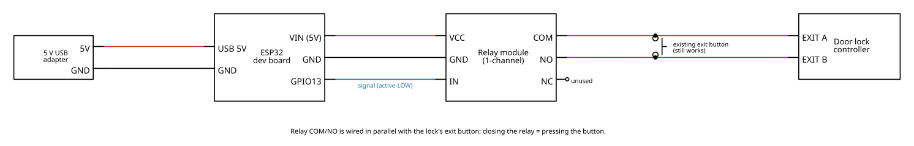

# hardware/

How the gate controller is wired. The explanation of the exit-button hack is in the [main README](../README.md#the-hardware-a-small-hack).

## Schematic



Generated from [`schematic.py`](schematic.py) with [schemdraw](https://schemdraw.readthedocs.io/):

```bash
pip install schemdraw==0.19
python hardware/schematic.py        # rewrites hardware/schematic.svg
```

Edit the script and regenerate; don't edit the SVG by hand.

## Parts (bill of materials)

| Part | Role | Notes |
|---|---|---|
| ESP32 dev board | Runs the gate firmware, BLE | Powered over USB |
| 5 V USB adapter | Powers the ESP32 (and the relay through VIN) | |
| 1-channel relay module | Acts as a second exit button | Input on **GPIO 13**, **active-LOW**. Uses COM + NO; NC is unused. |
| Door lock controller (existing) | Releases the lock when its exit-button input is shorted | Not modified |
| Exit button (existing) | Normal push-to-exit button | Still wired and working, in parallel with the relay |
| DS3231 RTC module (planned) | Trusted time for grant expiry and logs | I²C (SDA/SCL), coin-cell backup |
| Reed switch (optional, planned) | Confirms the gate actually opened | Decision D8 |

## Pin rules
- The relay input must **not** use a strapping pin (GPIO 0, 2, 12, 15). GPIO 13 is fine.
- The relay must **stay off through reset and power-up**. Set the "off" level before `pinMode(OUTPUT)`.
- Use **COM + NO** only, so a dead or unpowered relay means "button not pressed".
- The inside exit button and the mechanical key must work without the ESP32.

## To confirm on the real board
The schematic shows the current setup as described. Please check these against the actual wiring and fix `schematic.py` if anything differs:
- [ ] How the ESP32 is powered (USB adapter? from the lock's supply through a converter?)
- [ ] Whether the relay module's VCC comes from VIN (5 V) or 3V3
- [ ] That the relay contacts really are COM + NO across the exit-button terminals
- [ ] Whether the relay module is active-LOW (the firmware drives the pin LOW to open)
- [ ] Whether the exit-button input is a plain dry contact, with no voltage on it from the controller
